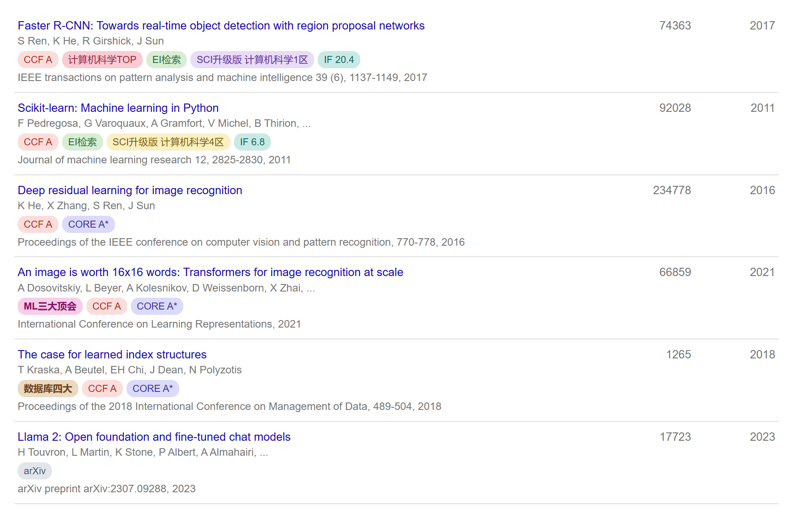

<div align="center">

# Scholar Rank

[简体中文](README.md) | [English](README.en.md)

**See journal and conference rankings directly alongside papers on Google Scholar.**




<sub>The preview uses real papers. Its citation counts come from Semantic Scholar, retrieved on July 28, 2026.</sub>

</div>

## What it does

Scholar Rank adds venue badges to Google Scholar profiles, search results, citing articles, related articles, and paper detail dialogs. Hover over a badge to see the venue's full name, research area, journal categories, and indexing details. Newly loaded papers are annotated automatically.

| Badge | Meaning |
| --- | --- |
| `ML三大顶会`, `数据库四大` | Custom groups for the three major ML conferences and four major database conferences; editable in the bundled tag file |
| `CCF A/B/C` | CCF recommended conferences and journals, seventh edition (2026) |
| `CORE A*/A/B/C` | CORE conference rankings (ICORE2026) |
| `ABDC A*`, `ABS 4*`, `AJG 2024 4*` | ABDC 2025, ABS/AJG 2021, and AJG 2024 business journal ratings |
| `UTD24`, `FT50` | UT Dallas 24 and Financial Times 50 journal lists |
| `国自然管理学部 A/B` | Important journals recognized by the NSFC Department of Management Sciences |
| `UTD24+Econ5` | Combined UTD24 and five leading economics journals group |
| `Nature Index 2026` | The 177 journals covered by Nature Index 2026 |
| `计算机科学TOP` | A top journal in the indicated CAS subject area |
| `EI检索` | Included in the bundled EI Compendex source list |
| `SCI升级版 计算机科学1区` | CAS journal division and broad subject area |
| `IF 8.7` | JCR impact factor; JCR quartiles Q1–Q4 can also be enabled |
| `预警 论文工厂` | A warning from the CAS International Journal Early Warning List |
| `arXiv`, `bioRxiv` | Preprint platform; preprints do not receive venue rankings |

Dissertations and patents are skipped. Most settings and some badges are currently displayed in Chinese; the profile statistics sidebar uses English labels.

## Author highlighting and profile statistics

The **Paper statistics** sidebar summarizes the papers currently loaded on a profile, including CCF categories and CAS journal divisions. Click a category to filter the list, and click it again to clear that filter.

- **First and last authors.** Select **First (incl. co-first)** or **Last** to highlight matching papers. Consecutive leading authors marked with `*`, `#`, `†`, or `‡` are treated as co-first authors. A truncated author list containing `…`, `...`, or `et al.` is not used to identify the last author. Single-author papers can match both roles and are counted once.
- **Name matching.** Profile names are matched to abbreviated author names. Hyphenated surnames, omitted middle initials, Chinese aliases in parentheses, and a former surname such as `Madeleine Torcasso (Durkee)` are supported. Add other spellings in Settings, one alias per line. **Highlight author name** controls name highlighting independently.
- **Combined filters.** Apply publication-year ranges, venue categories, and **Show only highlighted papers** together. Selected author roles are combined as a union; role, year, and category conditions are combined as an intersection. Papers with no year are excluded when a year range is active.
- **Citation metrics.** See paper count, total citations, h-index, and i10-index for highlighted papers alongside the totals for loaded papers. Citation counts are the current cumulative counts, not citations received only during the selected publication years. Crossed-out duplicate citations are excluded from citation metrics.
- **Load all papers.** Automatically click Scholar's own “Show more” button, with progress and a stop control. Statistics cover loaded papers, so use this before interpreting them as a full profile summary.
- **Copy or download a screenshot.** Export the current paper list and statistics as a PNG generated on your device. If clipboard access is unavailable, use **Download screenshot**. For very long lists, narrow the filters first.

Role, year, and display selections are retained for each profile in the current browser tab, including across a refresh.

## Installation

For a manual installation in Chrome or Edge:

1. Download the repository using **Code → Download ZIP**, then extract it. A Git clone works too.
2. Open `chrome://extensions/` or `edge://extensions/`.
3. Enable **Developer mode**.
4. Click **Load unpacked** and select the extracted folder that directly contains `manifest.json`.
5. Open a supported Google Scholar profile or search results page.

The ranking datasets and screenshot library are already bundled. No build, account, API key, or dependency installation is needed to use the extension. Keep the installed folder in place: the browser loads the extension from that location. After updating its files, reload the extension in the browser's extension manager and refresh Scholar.

Supported sites include the common `scholar.google.*` domains listed in the manifest and the mirrors `xueshu.lanfanshu.cn`, `scholar.lanfanshu.cn`, and `sc.panda985.com`.

## Settings and matching

Use the toolbar popup to enable or disable the extension and select a badge theme. Open Settings to toggle individual badge types, adjust text size and weight, add author aliases, and inspect the bundled dataset versions.

Six badge themes are available: soft fill, outline, solid, minimal text, square tags, and grayscale. The matching test in Settings accepts a venue string copied from Scholar and shows the matched records and lookup path.

Venue matching normalizes names, removes common publication prefixes and volume/page suffixes, and uses full names, acronyms, curated aliases, and conservative truncated-name matching. Ambiguous matches are left unlabelled. For an unrecognized truncated search-result venue, the extension can request that result's citation format from Scholar to recover its full name. Disable this behavior using `resolveTruncated` in Settings.

## Privacy

Ranking lookup and screenshot generation run on your device. Scholar Rank does not operate a data-collection server, include analytics or advertising, or send browsing or paper data to the developer.

Preferences, including any author aliases you enter, use the browser's sync storage and may be synchronized by your browser provider when browser sync is enabled. Profile filters and citation-completion caches use tab-scoped session storage. Optional venue completion requests go to the Scholar site you are already using; loading additional papers also uses that site's own controls. Screenshot generation may load images already referenced by the page, and saves or copies the result only when you request it.

See the [Privacy Policy](docs/PRIVACY.md) for details and permission explanations.

## Data sources

| Dataset | Source |
| --- | --- |
| CCF 2026, seventh edition | [ccf.atom.im](https://ccf.atom.im/) · [CCF directory](https://www.ccf.org.cn/Academic_Evaluation/By_category/) |
| CORE (ICORE2026) | [CORE Conference Rankings](https://portal.core.edu.au/conf-ranks/) |
| CAS journal divisions 2025, JCR 2025, journal warning list 2025 | [hitfyd/ShowJCR](https://github.com/hitfyd/ShowJCR) |
| EI Compendex source list | [HiddenStrawberry/EI-COMPENDEX-SOURCE-LIST](https://github.com/HiddenStrawberry/EI-COMPENDEX-SOURCE-LIST) |
| ABDC 2025 | [ABDC](https://abdc.edu.au/abdc-journal-quality-list/) · [structured data](https://github.com/P-M-Ferreira/ranking/tree/main/journal-ranking-app/data) |
| ABS/AJG 2021 and AJG 2024 | [Chartered ABS](https://charteredabs.org/academic-journal-guide-2024/) · [structured data](https://github.com/jusi-aalto/biz-journals) |
| UTD24 and FT50 | [UT Dallas](https://jsom.utdallas.edu/the-utd-top-100-business-school-research-rankings/index.php) · [FT50 structured data](https://github.com/jusi-aalto/biz-journals) |
| NSFC management journals | [Directory mirror](https://static.hhkaobo.com/upload/editor/72f47437-e6ba-4df1-8740-f48d95f519f6.pdf) |
| Nature Index 2026 | [Nature Index FAQ and journal lists](https://www.nature.com/nature-index/faq) |

Thanks to the projects and organizations that make these datasets available. Journal rankings and impact-factor data remain the property of their respective rights holders.

Matching is based on venue names and can miss or misidentify renamed, ambiguous, or newly added venues. The bundled EI list is the 2019 edition. Check the relevant official source for formal assessment, promotion, funding, or degree requirements.

## Contributing

- [Report a bug](https://github.com/Day333/scholar-rank/issues): include the exact venue or author text shown by Scholar, the affected page, and the expected result.
- [Send a pull request](https://github.com/Day333/scholar-rank/pulls): matching fixes often need only an entry in `src/data/aliases.json`. Custom groups live in `src/data/tags.json`.

```sh
npm ci
npm test
npm run test:browser
npm run probe -- "IEEE Internet of Things Journal 11 (3), 4000-4012"
npm run serve
```

`npm run serve` opens a local preview server at `http://localhost:8123/test/fixture.html`. Browser tests use an isolated Chrome or Edge context and do not use your personal browser profile. See the [development guide, in Chinese](docs/DEVELOPMENT.md) for the matching pipeline, datasets, and build commands.
