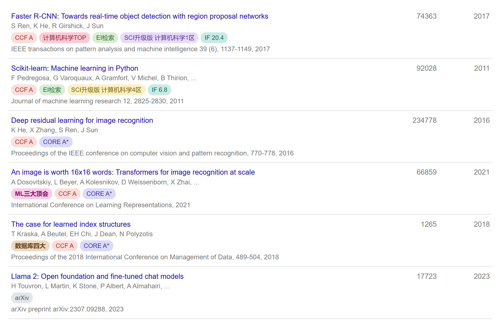

# 学术分级标注 · Scholar Rank

[简体中文](README.md) | [English](README.en.md)

**在 Google Scholar 上查看期刊会议评级，筛选论文并生成个人主页统计。**

**[免费安装 · Chrome 应用商店](https://chromewebstore.google.com/detail/pjeccpgooejgnnbcjickjcgoamnghile)**

## 主要功能

- **评级徽章**：在个人主页、搜索结果等页面标注期刊会议级别，鼠标悬停可查看详情。
- **作者识别**：识别第一作者、共同第一作者和末位作者，支持姓名高亮。
- **论文筛选**：按发表年份、作者角色和评级组合筛选。
- **统计与截图**：汇总已加载论文的篇数、引用数、h-index 和 i10-index，复制或下载统计截图。
- **外观设置**：切换徽章风格、调整字号，单独开关各类标注。

## 安装与使用

1. 打开 [Chrome 应用商店](https://chromewebstore.google.com/detail/pjeccpgooejgnnbcjickjcgoamnghile)，点击「添加至 Chrome」。
2. 打开 Google Scholar 个人主页或搜索结果页，徽章会自动出现；点击工具栏扩展图标可调整设置。

无需注册或 API Key。Edge 和源码安装方式见 [手动安装](docs/USAGE.md#手动安装)。界面以中文为主，统计侧栏使用英文。

评级匹配、统计和截图在本机完成；设置可能通过浏览器账号同步，可选的出处补全会请求当前 Scholar 站点。详见 [隐私政策](docs/PRIVACY.md)。

## 详细说明

[使用指南](docs/USAGE.md) · [徽章与数据来源](docs/DATA.md) · [隐私政策](docs/PRIVACY.md) · [开发说明](docs/DEVELOPMENT.md)

## 反馈与贡献

这是一个免费扩展，欢迎多 [提 issue](https://github.com/Day333/scholar-rank/issues)，反馈漏标、误标、作者识别问题或功能建议，一起把它完善。
请附上相关页面链接、出处或作者原文，以及预期和实际结果；截图也很有帮助。

也欢迎 [提交 PR](https://github.com/Day333/scholar-rank/pulls)。
